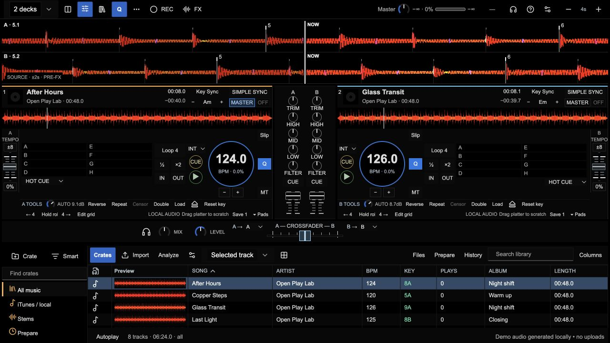

# Open Play

Independent DJ software for mixing local music. Two or four decks, readable frequency-colored waveforms, a central mixer and a library with waveform previews.

[Try locally](#run-locally) · [User manual](https://open-play-help.vercel.app/) · [Contribute](CONTRIBUTING.md) · [Report a bug](https://github.com/jpoindexter/open-play/issues/new/choose) · [MIT license](LICENSE)



*Workspace reference with generated demo tracks from the illustrated manual. The guide identifies its version baseline; screenshots are not proof of current audio or hardware acceptance.*

## Status

**Early development; contributors welcome.** The goal is a useful, reliable public Mac local-audio beta. A public desktop installer has not been released. The latest recorded private candidate is **0.1.151**; musical Sync, audible pops, matched output volume and final installation/signing acceptance still have open gates. See [known issues](docs/beta/KNOWN_ISSUES.md) and the [beta plan](docs/delivery/PUBLIC_BETA_PLAN.md).

The source is available to study, fork, modify and contribute under MIT. It is not a claim of complete Serato, rekordbox or Traktor parity. Experimental and simulated features are labelled. Original music and personal library data are not required to contribute.

## What is here

- Two- and four-deck workflows, Compact/Full decks and horizontal/vertical waveform views.
- Local audio import, transport, tempo, jog nudge, beatgrids and outgoing-master Sync workflows.
- Channel gain, EQ, optional filter, level faders, headphone monitor controls and crossfader.
- Temporary Cue, hot cues, loops and other performance controls.
- Crates, search, metadata, local persistence and full-track library previews.
- An illustrated, searchable [manual](https://open-play-help.vercel.app/), plus an Electron test host.

Browser decoding varies. Independent headphone output and controller routing require suitable hardware; a passing software check does not certify them. Advanced DSP, stems, video and provider fixtures have separate setup and acceptance limits.

## Run locally

The browser workspace is the simplest way to explore or contribute. No npm install is needed to use the committed UI bundle.

Prerequisites: Git, Python 3.9+ and a recent browser. This server command has been checked on macOS; Windows server support is not established.

```sh
git clone https://github.com/jpoindexter/open-play.git
cd open-play
python3 scripts/serve_prototype.py --port 8848
```

Open **http://127.0.0.1:8848/prototype/workspace-preview.html**. Stop the server with **Ctrl+C**. If that port is busy, choose another port and use the same one in the URL.

Start at low output volume. Use the original generated demo tracks or import audio you have permission to use. Keep your originals: metadata backups do not contain audio or recordings, and Files distinguishes durable storage from session-only imports. The [first-mix guide](docs/beta/QUICK_START.md) explains the workflow.

The loopback server does not install optional stem models or upload your library. Optional local processing needs its separately documented runtime.

### Development commands

Use Node.js 24 for the existing JavaScript checks. Run only the check relevant to your change, for example:

```sh
node --test prototype/repeat-end.test.mjs
```

For edits to the Astryx UI source, rebuild its committed bundle:

```sh
cd prototype/ui
npm ci --ignore-scripts
npm run build
```

For manual-site work, follow [help/README.md](help/README.md). The desktop packaging scripts currently depend on maintainer-only generated fixtures; they are not a fresh-clone installer command. Use the browser workspace unless you are specifically working on the [Electron host](desktop/README.md).

## Contribute

**Fork → create a branch → make one focused change → open a pull request.** See [CONTRIBUTING.md](CONTRIBUTING.md) for setup, code boundaries, focused checks and review expectations.

Useful contributions include reproducible Sync/audio bug reports, clearer waveform feedback, import/recovery improvements, control accessibility, documentation and carefully scoped fixes. For a large feature, open an issue first so we can agree on scope.

- [Bugs and feature requests](https://github.com/jpoindexter/open-play/issues/new/choose)
- [Pull requests](https://github.com/jpoindexter/open-play/pulls)
- [Private security reports](SECURITY.md)

Do not attach songs, full mixes, library backups, credentials or private research dumps. Generated audio and small redacted reproductions are preferred.

## Code map

| Directory | Purpose |
| --- | --- |
| `prototype/` | Browser DJ engine, workspace, controls and focused checks |
| `prototype/ui/` | Astryx UI source; custom DJ controls remain separate |
| `desktop/` | Electron host and private packaging tools |
| `help/` | Static manual source and screenshots |
| `scripts/` | Loopback server and development/research tools |
| `docs/` | Design decisions, evidence, limitations and delivery plans |
| `experiments/` | Isolated audio investigations; not default production backends |

## License and attribution

Original Open Play code is [MIT licensed](LICENSE). Third-party code retains its own licenses and notices; see [NOTICE](NOTICE). Optional model weights and experimental integrations require their own license checks. The app is independent and is not affiliated with Serato, AlphaTheta/rekordbox, Native Instruments or Allen & Heath.

## Maintainer notes and history

The [current handoff](handoffs/current.md) and [build plan](FULL_BUILD_PLAN.md) retain detailed evidence and remaining gates. [Earlier README checkpoints](https://github.com/jpoindexter/open-play/blob/4ab279c2954ab6a4d00bdd0c2c820205053b541c/README.md) remain in Git history. The [original project brief](PROJECT_PROMPT.md) is preserved.
