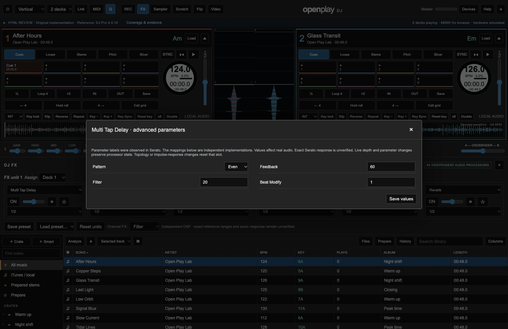

# Browser DSP continuation — executed evidence and open contracts

Date: 16 October 2026. This is an evolving review record. **Full 1:1 parity remains NOT PASSED. Native development is not approved.** The current worktree is ahead of the DSP checkpoint 1cebb52; read the latest candidate hash in the handoff before auditing.

## Actual behavior added

The prototype now contains independent DSP for all 59 named DJ effects: the original four Web Audio processors plus 55 AudioWorklet processors. Four Channel FX have separate implementations. The effect chain keeps unaffected processors alive during ordinary control changes; changing an effect replaces that slot. These are real audio operations, but their control ranges and sound are not claimed identical to Serato.

Signalsmith Stretch 1.3.2, under MIT, runs its actual vendored WASM in a cancellable browser Worker. Deck tempo can preserve pitch; key shifting can change pitch independently. Engine transport, reverse and loops use original-track time while the rendered buffer has a different duration. This is buffered processing and can pause to prepare audio; it is not a proven low-latency native time-stretcher.

Stems preparation runs actual local SCNet-large inference through the loopback service. It returns four WAV sources, decoded and mixed by the browser. The original mix is used when all stems are enabled without effects; isolated buffers are used otherwise. SCNet code and checkpoint have an explicit author MIT grant. Two held-out music excerpts improved all eight per-source SI-SDR values over Spleeter, but one reconstruction test failed its unchanged 3% gate at 3.025%. Quality parity is open. The model and isolated Python environment remain ignored local assets, with provenance and setup recorded in the research report.

The analysis Worker estimates BPM, key/chroma, RMS, sample peak and an initial constant grid from decoded PCM. Unknown estimates stay unknown. RMS is not LUFS, sample peak is not true peak, and downbeat/meter/variable-tempo accuracy are unverified. The main UI import/decode/Worker path measured an original 128 BPM fixture at 127.99 BPM, recognized a generated C-major fixture, and left silence unknown. A manual 133 BPM edit with grid protection survived reanalysis, page reload and identical-file reimport. Requested reanalysis also respected the locked grid.

## Executed checks

Each row states the path actually run. Counts are not additive feature coverage.

| Path executed | Result | What this does not establish |
|---|---|---|
| Real AudioWorklet graph, 55 DJ + four Channel processors | 59/59 pass; `extended-effects-browser-results.txt` | Exact Serato transfer functions, all parameter combinations, 4-deck sustained load |
| Original four processors' observed controls, actual offline graphs | 16/16 pass; `native-fx-controls-browser-results.txt` | Every numeric value or exact reference response |
| Original four processors' live updates plus same-slot effect replacement | 5/5 pass in same artifact | Every topology change is clickless or gapless |
| Observed FX control contrast in actual AudioWorklet graphs | 220/220 pass; `observed-fx-controls-browser-results.txt` | Exact reference ranges or sonic equivalence |
| Longer adversarial FX graphs: decay, public update, sweep continuity and late Stretch markers | 9/9 pass; `fx-adversarial-browser-results.json` | Universal stability, all settings or vendor sound matching |
| Current integrated audio/module baseline | 20/20 pass; `behavior-results-dsp-integration.txt` | Full UI, physical devices or exhaustive feature coverage |
| Sampler keylock and global output route through actual engine | 17/17 pass; `sampler-browser-results.txt` | Physical headphone output or complete sampler parity |
| Pitch Play cue/range/key lifecycle through actual engine | 13/13 pass; `pitchplay-browser-results.txt` | Exact vendor harmonic-sync policy or hardware pad timing |
| Real pitch Worker in browser | 12/12 pass; `keylock-browser-results.txt` | Listening quality across a music corpus, native latency |
| Actual AudioEngine master frequency, rate, reverse, loops, cancellation, stem isolation and FX lifecycle | 18/18 pass; `audio-integration-browser-results.txt` | Physical controller, headphone routing, reference sound matching |
| Channel Filter/Echo/Space/Noise and four Stems exit routes, master FFT/RMS | 27/27 pass; `channel-stems-browser-results.txt` | Sustained load or exact reference envelope/transport policy |
| Captured stem exit AudioBufferSource graph and exact end silence | 2/2 pass; `stem-exit-browser-results.txt` | Real-time pre-trigger history across transport discontinuities |
| Actual analysis Worker with original generated signals, cancellation and malformed input | 13/13 pass; `analysis-browser-results.txt` and main-UI evidence | Accuracy on real music or every queue/UI edge |
| Local preparation through main UI, first Spleeter then SCNet | Ready and four decoded buffers; saved UI artifacts | Isolation quality, long-file memory/latency, real-time streaming separation |
| Service ownership, traversal protection, cancellation and timeouts | 10/10 checks re-executed at 14:42 UTC; `stem-service-review-results.json` | Full deployment security or production uptime |

Pure signal checks additionally cover 80 extended-FX cases, 8 keylock cases, 65 analysis cases and 11 finite stem-exit cases. Read the scripts and research reports for exact tolerances. They complement, rather than replace, browser and main-interface execution.

## Reference investigation

All 59 advanced effect strips were selected in the installed Serato DJ Pro 4.0.10.213 while decks stayed paused. The inventory records 236 visible parameter labels and session values, with hashes of private local screenshots. Eighteen omitted OCR digits were manually read as Beat Modify = 1. Session values are not factory defaults; ranges and alternative enumerated modes remain unmeasured. See `../research/FX_OBSERVED_PARAMETERS.md` and JSON.

The official Stems guide specifies mute plus echo-out/brake. Its instrumental-effect animations visibly deactivate melody, bass and drums while leaving vocals active. This corrected the earlier live-delay implementation. No proprietary DSP, model, artwork or source was copied.

## Findings being closed

1. Live per-stem AudioWorklet history now supplies only played audio. The short-loop regression rejected unplayed-prefix audio at −192.71 dB while preserving the played signal at −42.01 dB.
2. Exit latches now survive pitch/rate/seek/reverse restarts. A completed brake remained exactly silent after pitch preparation. Active tails now retain the captured pitch through pitch/rate/seek/reverse replacement and actual natural reverse end; explicit pause and emergency stop reach RMS zero. The new 27-check suite exercises these acoustic paths. Exact vendor transport policy remains unverified.
3. Observed reference controls differ from some initial independent processor controls. `FX_CONTROL_GAP_MATRIX.md` tracks family-by-family functional mappings. Exact ranges/enums and sound matching remain open.
4. Analysis cancellation followed immediately by new work now drains the new job; 14/14 controller checks passed and the old implementation fails that regression. Browser UI cancellation during a large import has not yet been exercised.
5. Sampler keylock, pending-start cancellation, repeat coordinates and global Master/Deck output routing passed 17/17 actual-engine checks. A new public-interface check closes the earlier inconclusive route measurement: status remained Playing for both samples; Deck1 route with fader0 produced meter0, then Master produced0.01887. Browser buses only; physical headphone routing remains unverified. See `sampler-main-ui-route-results.json`.
6. Pitch Play passed 13/13 actual-engine checks and 20/20 policy checks: paused cue audition/release, cancellation, note ownership, range pitch, Play latch, key sync and reset. The main UI exposes the Hercules ranges and applies key changes. Generic Pitch Play documentation conflicts with the Hercules Middle layout; the prototype follows the device guide and records that choice.

## Reproduce

Run `python3 scripts/serve_prototype.py`, open `http://127.0.0.1:8768/prototype/`, and use the separate test pages linked by their filenames above. Test pages disconnect speaker output. Main-interface playback uses the browser's default device and must be stopped after checks.

Key research: `../research/KEYLOCK_EVALUATION.md`, `STEMS_RUNTIME_EVALUATION.md`, `AUDIO_ANALYSIS_EVALUATION.md`, `FX_BEHAVIOR_CONTRACTS.md`; independent findings: `ADVERSARIAL_AUDIO_REVIEW.md`.

## Inventory reconciliation

The current inventory contains 495 detailed interaction requirements across 110 groups. The 138 added rows fill 22 of the previously empty 24 groups. AUD-005 (independent-device clock drift) and SYS-006 (reproducible open-source build provenance) are Open Play engineering goals without invented Serato manual interactions. All 59 FX strips and 236 labels are observed; all 55 extended control schemas map their 220 labels to independent audio behavior. The original four effects' 16 controls also passed separate signal contrasts. Exact ranges, mode catalogs and response matching remain open. Spotify Crates/Prepare/History apply from 4.0.4 and therefore to the installed 4.0.10 reference. See `REQUIREMENT_GAPS_REVIEW.md`. These counts do not prove exhaustive coverage.

## Latest workflow and adversarial follow-up

The first Stems pad action now starts real local preparation and applies its requested action on completion; it no longer requires a manual preparation step. The Analyze Stems load preference queues the same service. Both were exercised through the main UI: After Hours reached ready then vocal-muted, and Glass Transit reached ready after load without any Stems pad trigger. A native drag into Prepared stems emitted a real drop event and queued preparation; loading that track afterward showed four-source SCNet readiness. See `stems-crate-drag-events.json`. Matching requests share a promise/progress stream; 12 adapter checks cover this with mocked network/decode, separately from real inference.

A newly opened preparation dialog initially displayed a stale status for automatic work. It now subscribes to that active job and uses captured controls so an old completion cannot change a different dialog. Cancellation/retry/coalesced-pad UI evidence is recorded in `stems-auto-preparation-ui-results.json`.

Independent review after the 220 short graph contrasts found four concrete defects: unstable Multi Tap feedback, insufficient history after timing updates, fractional-direction sweep resets, and truncated Stretch exit read extent. All four corrections pass 33 targeted real-kernel checks and 9 actual browser Worklet regressions. The frozen runtime also passed a fresh 220-control contrast run and 59 effect graphs plus five original-processor lifecycle checks. These establish the specified regressions, not final DSP equivalence. See the current adversarial review record.

The drag investigation also found a startup race: static toolbar controls accepted
changes before their handlers were installed. Startup regions now remain inert
until initialization completes. A fresh main-page reload followed immediately
by Library selection produced the matching visible layout and ready state.

## Main-interface continuation snapshot

The reloaded main prototype reached ready, accepted Library then Vertical layout,
and saved/reopened Multi Tap Delay Pattern=Even and Feedback=60. This verifies the
visible control/persistence path; graph audio is covered separately above. Both decks
remained paused.

## Selected-stem transport follow-up

The independent Stem Slip implementation passes30/30 actual browser audio checks,
30/30 kernel/engine-boundary checks and19/19 controller lifecycle checks. Real main
controls prepared SCNet audio, preserved focus, performed quick/held scratch-release
and rejoined while armed; playback was explicitly paused. See
[STEM_SLIP_FUNCTIONAL_REVIEW.md](STEM_SLIP_FUNCTIONAL_REVIEW.md) for full evidence,
retained failures and T10/reference/combined-workflow/resource limits.
