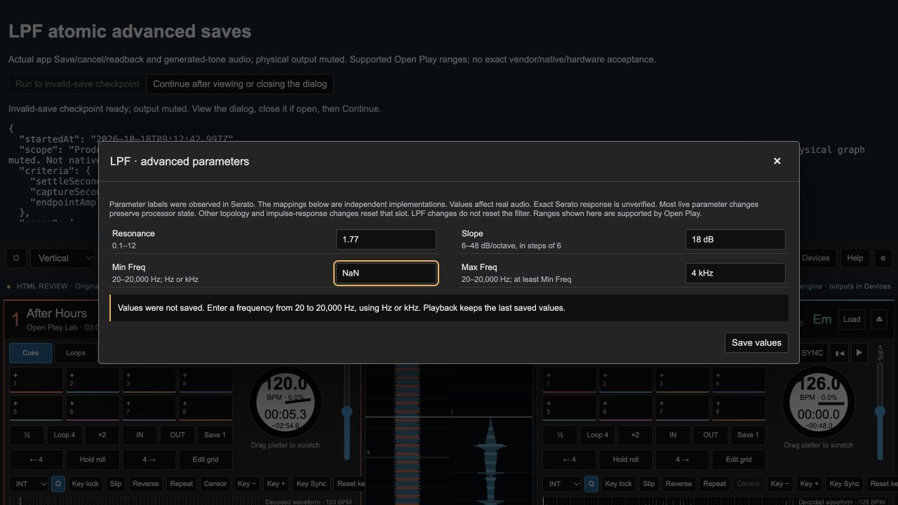

# LPF advanced Save: reject invalid edits without changing live audio

18 October 2026 · plan136 · browser source based on f1bff54. This change is **not packaged in the prepared desktop0.1.23**. The physical Hercules test remains the next core-mixing milestone. Full Serato parity is unaccepted.

## Reproduced failure and correction

The production LPF advanced dialog saved all four raw strings before applying the effect. During playback, changing Slope12→18dB and Max400Hz→4kHz together with Min`NaN` closed the dialog, changed the saved settings and silently used the DSP's200Hz minimum fallback. Independent captured100/2000Hz amplitudes confirm the changed18dB/200Hz response. Before original429,003bytes, SHA256`b1ab5fd56a08fbe3a872b2e1d49f5e807a4b8daee17a0b77a1f97f492760f823` is retained privately; it is an expected failing reproduction.

The dialog now validates a complete proposal before committing it. A rejected Save leaves all saved parameters and the playing filter untouched, keeps the draft open, explains the error, marks invalid fields and focuses the first invalid field. Editing clears stale error state; the next Save rechecks the complete proposal. Valid corrected values commit together. Cancel discards draft edits. Other effects retain their previous Save behavior.

`prototype/lpf-parameters.js` contains Open Play's supported ranges and strict numeric/unit parser. Resonance0.1–12; slope6–48dB/octave in steps of6; frequencies20–20,000Hz with Min≤Max. Equal endpoints are supported. Bare numbers, Hz/kHz, scientific notation and optional dB/oct/octave suffixes normalize to canonical stored strings. Blank/nonfinite/overflow/trailing-junk and unsupported values are rejected. These limits follow the existing independent DSP policy; they are **not verified Serato limits**. No new model, service, library or DSP algorithm is introduced.

## Executed evidence

`node scripts/check_lpf_parameters.mjs` passes17 focused cases covering supported boundaries/units/defaults, invalid syntax/types/nonfinite/ranges/steps, crossed endpoints, complete rejection and input immutability. This is parser evidence only.

One actual browser app workflow executes seven states with production Play/Save/cancel/readback controls, generated stereo DC+100/2000Hz engine buffers and physical output muted:

1. Valid12dB/400Hz baseline.
2. Mixed valid edits plus NaN minimum rejected; Min Freq focused.
3. Crossed900/800Hz endpoints rejected together; Min Freq focused.
4. Invalid resonance−1 and slope19 rejected together; Resonance focused.
5. Corrected`2e0`, `18 dB/octave`, `.4 kHz`, `400 Hz` commit as`2`, `18 dB`, `400 Hz`, `400 Hz`.
6. Further valid draft edits canceled; reopened values remain the last saved settings.
7. Normal Stop produces exact silence.

Fourteen retained Float32 channel windows, each13,230frames at44,100Hz, independently hash/finite checked. Rejected edits retain baseline tone amplitudes and DC within fixed1%/.0001 tolerances. Corrected Save reaches the independently calculated18dB/400Hz response; Cancel retains it. Maximum endpoint amplitude relative error`5.154557849e−7` versus the predeclared1% criterion. Same playing voice retained before Stop; final two windows are exactly zero. This measures settled sound, not the entire transition waveform; plan135 separately retains the measured live-transition evidence.

Original after1,002,092bytes/SHA256`1107ce31dab09521bf2f5a697e53a3f3226d913935564dacd2d854e31de90f03`; normal browser Download is byte-identical. Nine fetched source identities are stable before/after and match current production/harness bytes. Error screenshot was actually inspected: visible field focus/range hints/inline alert. Error fields expose custom validity, `aria-invalid` and error/hint descriptions. Screen-reader operation was not exercised.

Reports: [before](lpf-validation-before-results.json), [after](lpf-validation-after-results.json), [parser](lpf-validation-policy-results.json). Re-run retained-PCM inspection with`python3 scripts/inspect_lpf_validation.py`; ignored originals are required. Interactive diagnostic:`prototype/lpf-validation-harness.html` via a local asset server; it pauses at the invalid Save for inspection, then Continue finishes the remaining states. This helper generates its own audio and never requires a timed physical capture.

## Boundaries and next work

Scope is this LPF dialog only. Imported/legacy presets and direct API specifications still reach the existing DSP fallback/clamping policy; no migration or universal FX validation is claimed. Exact vendor controls/transfer, pure6dB resonance, extreme rates/channel changes, resource/CPU/underrun behavior, music, native execution and physical sound remain open. No59-effect, Stems/keylock, native or broad regression matrix was repeated. A metadata inspection initially assumed the Trello card manifest was an object rather than its actual array; no product data changed from that inspection error.

The future packager now declares both LPF modules critical, but recipe version remains0.1.23. Do not rerun it over the preserved artifact: any justified later batch requires a deliberate version bump and actual packaged execution. Current desktop23/profile272mappings/launchers remain unchanged. Fresh read-only native observation still shows23, zero playing, both00:00.0 and Master−12dB. Serato remains closed. Main8768service stays running; the isolated18877helper is cleaned up after evidence retention.

Human re-entry remains: left physical Hercules Play→deck1/RCA sound→same button Stop, then cue/mixing/Sync/controls one action at a time. No readiness request or timed capture while Jason is away. Full110featuregroups/522requirements,9beta deltas,26release checks,55extended effects/Stems/keylock acceptance, model/effort routing and original prompt remain unchanged. Full Claude audit is still unlaunched.
