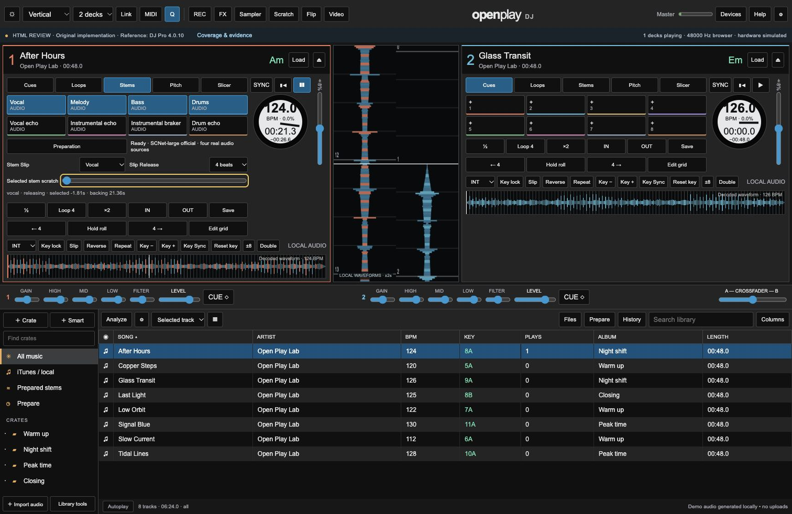

# Stem Slip — independent browser implementation and evidence

16 October 2026. **Full Serato parity is not passed; native development is not approved.**
Reference source conflict and proposed policies: [Stem Slip evaluation](../research/STEM_SLIP_EVALUATION.md).

## Actual implementation

`stem-slip-kernel.js` reads four actual prepared PCM sources with separate canonical
and selected-group positions. Its AudioWorklet exposes four stereo outputs. Vocal
selection manipulates vocals; Instrumental selection manipulates melody, bass and
drums. Complementary sources continue on the canonical clock. This is independent
audio transport, not a mute change or repeated seek of the combined track.

The selected read head supports signed velocity, cues, reverse and loops. Release
0 rejoins immediately; ½/1/2/4 beats play the declared selected-source fragment and
rejoin using the advancing audio beat clock. A fragment extending before track zero
contains silence padding. These release-fragment, quantization and mixer policies
are independent choices; the exact vendor response remains unmeasured.

Crossfader gain applies to the selected group, while complementary stems bypass
that factor. Both traverse shared channel level/trim/EQ/filter and deck FX. Finite
Stems exit audio follows its corresponding per-stem route. Original-mix fallback
is disabled while timelines are separated. Base stem masks remain independent.

A paused cue auditions only the selected sources while the canonical cursor stays
frozen. Play during the hold starts canonical playback; release then rejoins.
Explicit pause stops both groups and retains mode selection; load/eject, emergency
silence and canonical track end disarm. Mode/group changes invalidate old owners.
Worker keylock replacement keeps the old effective playback rate while preparing,
then changes buffers, scale and rate together. The requested rate and effective
audio rate are deliberately separate during this interval.

The main interface offers a latched mode selector, musical-release selector and
native keyboard/pointer scratch range in the Stems tab. Cue holds route through
the selected-group API. These browser controls do not prove physical T10 chord,
jog or LED mapping, nor exact Serato layout equivalence.

## Executed evidence

| Path | Evidence | Boundary |
|---|---|---|
| Actual four-source engine/AudioWorklet, master FFT/RMS, real cue controller | `stem-slip-browser-results.json`, 30/30 pass | Specific independent cases; no T10/vendor acceptance |
| PCM kernel plus real engine methods at deferred rendering/worklet boundaries | `stem-slip-kernel-results.json`, 30/30 pass | Browser scheduling/routing is established separately |
| Actual UI controllers/engine owner methods with controlled DOM/voice collaborators | `stem-slip-ui-lifecycle-results.txt`, 19/19 pass | Does not alone establish native browser focus or audio |
| Main UI local SCNet preparation, focus, held/quick keyboard gestures, release/rejoin and explicit pause | `stem-slip-main-ui-results.json` and snapshot below | Browser observations; physical outputs and reference matching unverified |
| Existing engine paths after introducing split transport | `audio-integration-stem-slip-regression-results.txt`, 18/18 | Tested ordinary paths, not exhaustive combinations |
| Existing Channel/Stems tail paths after routing changes | `channel-stems-stem-slip-regression-results.txt`, 27/27 | Scoped acoustic lifecycle regression |
| Ordinary cue/Slip/audio/module baseline | `behavior-results-stem-slip-integration.txt`, 20/20 | Full UI/hardware parity not established |

The browser suite measures cue markers, backward/forward selected read heads,
unaffected backing and another deck at a crossfader cut, shared level, custom masks,
all release lengths, tempo change during release, paused audition/Play latch,
early release, global seek, group switch, keylock ownership, selected exit routing,
silence and track end. Initial arming while tempo changes checks the still-audible
old voice, its clock, and the latest buffer scale/rate on activation.

## Failures retained and corrections

- Initial audio run was 27/28: the shared-level test sampled a 170.7 ms analyser
  history after only 220 ms, including the earlier gain ramp. The corrected fixture
  waits the full history plus 150 ms, retaining RMS < 1e-4. The initial result remains
  in `stem-slip-browser-results-initial.json`; it is not presented as a pass.
- Reused physical key/pointer identifiers allowed an old continuation to end a
  newer gesture. Each press now has a unique engine owner; old failures cannot
  delete newer physical-control ownership.
- Preparation renders removed keyboard focus. A durable focus intent now survives
  progress renders and is canceled when the user moves focus or interacts elsewhere.
- A quick key tap could be discarded before asynchronous begin. Normal release can
  commit its requested scratch while canonical playback continues; cancellation,
  blur, load/mode replacement and a paused release cannot revive it later.
- Older rate requests could overwrite newer tempo-synced FX metadata. Request
  tokens and track/mode/transport checks guard those writes, including equal-value
  replacement. Initial arming also rerenders superseded tempo/pitch candidates
  while retaining the old effective clock until the handoff.

## Remaining acceptance

T10/4.0.10.213 initial masks, button-order/release conflict, exact roll quantization,
instrumental crossfader symmetry, vendor mixer/PFL topology and hardware mapping
remain unverified. Browser reverse/loop entry currently has narrower kernel evidence;
all combinations with Pitch Play, Flip, Slicer, recording and device disconnect need
their own actual workflow checks. Sustained load, scratch listening quality,
long-file memory/latency and reference sound matching remain open.

Preparation currently has prototype resource bounds: 10-minute tracks, 128 MiB
decoded WAV uploads, four queued/running jobs and a 15-minute worker timeout. These
are disclosed limits of this implementation, not a completed no-limits product.
SCNet quality also retains the failed 3% reconstruction gate at 3.025%.

Reproduce with `python3 scripts/serve_prototype.py`, the public Run button at
`/prototype/stem-slip-integration-test.html`, and the main Stems controls. Test-page
audio is disconnected from speakers. Stop main-interface playback after checks.

